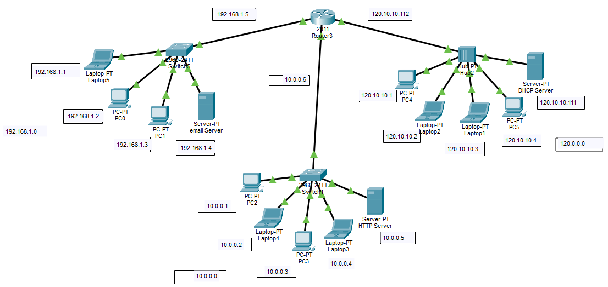
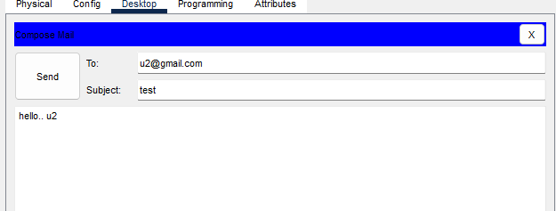
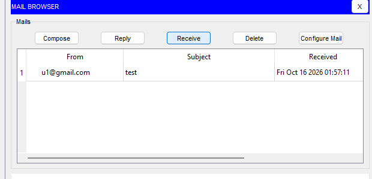
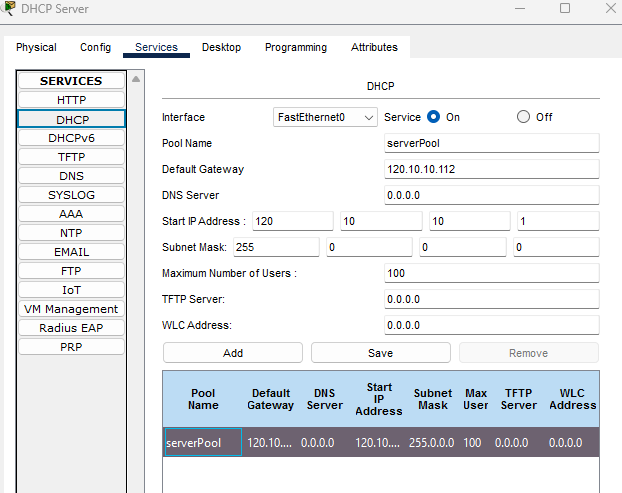
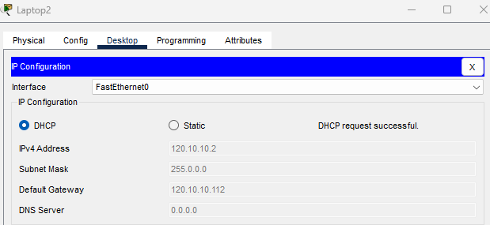
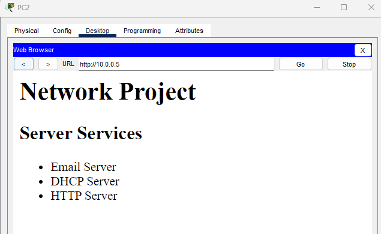
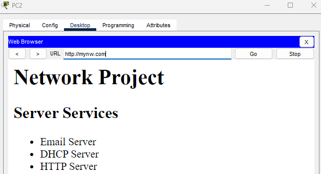

# Business Network Design & Simulation

**Academic Project | Management Information Systems | Cisco Packet Tracer**

## Overview

This project designs and simulates **three interconnected local area networks (LANs)** in Cisco Packet Tracer. Each LAN supports a different service: email communication, automatic IP address assignment, or web access. A router connects the three segments and provides communication between them.

## Network Architecture

*Figure 1. Overall topology of the three simulated networks.*

| Network | Purpose | Key configuration |
| --- | --- | --- |
| **LAN 1 — Email** | Send, receive, and reply to messages | Static IP addressing; email server with SMTP and POP3 |
| **LAN 2 — DHCP** | Assign host IP addresses automatically | DHCP server and client IP configuration |
| **LAN 3 — Web & DNS** | Access a local web page by IP address or domain name | HTTP server, DNS record, and static IP addressing |

## Implementation

- Designed the topology using a router, switches/a hub, end-user devices, and servers.
- Configured IP addressing, subnet masks, default gateways, and router interfaces for the three networks.
- Set up **SMTP** and **POP3** on the email server and configured email clients.
- Enabled **DHCP** and configured an address pool for automatic client addressing.
- Configured **HTTP** and **DNS** services for access to a hosted web page.
- Used Packet Tracer simulation tools and device interfaces to demonstrate network behavior.

## Simulation & Test Evidence

The screenshots below come from the project report.

### 1. Email communication

The report documents composing and sending an email, receiving it, and replying through the simulated email service.

| Sending a message | Received message |
| --- | --- |
|  |  |

### 2. DHCP address assignment

The DHCP server was configured with an address pool, and a client screen shows a successful DHCP request.

| DHCP server configuration | Successful client request |
| --- | --- |
|  |  |

### 3. HTTP and DNS access

A client web browser displays the hosted **Network Project** page when accessed using either the server IP address or its configured domain name.

| Access via server IP | Access via domain name |
| --- | --- |
|  |  |

## How to Open the Simulation

1. Install or open **Cisco Packet Tracer**.
2. Download [`projectNW3.pkt`](projectNW3.pkt) from this repository.
3. Open the `.pkt` file in Cisco Packet Tracer.
4. Explore the three LANs and inspect the email, DHCP, HTTP, and DNS server settings.
5. To review the demonstrations, use the devices' **Desktop** applications (such as *Email*, *IP Configuration*, and *Web Browser*) and Packet Tracer's **Simulation** mode.

## Tools & Technical Skills

**Cisco Packet Tracer** · Network Topology Design · IPv4 Addressing · Routers & Switches · DHCP · DNS · HTTP · SMTP · POP3 · Network Simulation

## Project Files

- [`projectNW3.pkt`](projectNW3.pkt) — editable Packet Tracer simulation.
- [`Network_Project_Report.pdf`](Network_Project_Report.pdf) — full English academic report with configuration steps and screenshots.
- [`screenshots/`](screenshots/) — supporting figures extracted from the report.
